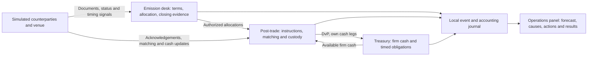

# Banco Vivo Investment Banking

## Scope and isolation

Run a local corporate debt capital markets simulator at 127.0.0.1:3100. Its
participants, clock, custody, settlement accounts and journal belong to the
simulator. It has its own process, HTTP routes and SQLite store under
`data/investment-banking`. It neither imports the Banco Vivo core nor reads
its configuration, data, accounts or API. No browser request leaves localhost.

The reference case is a synthetic debenture. The desk receives a priced and
allocated book and follows it through closing and settlement. Issuer,
coordinator, counsel, investors, custodian, clearing and funding counterparty
are simulated roles. Observations and work completions model what they report
to the desk, without external credentials or connectivity.

The core bank and IB share only the repository. A future shared launcher can
link to both independent URLs without creating an accounting or runtime dependency.

## References and design decisions

- [ICMA and AFME, Guide to Infrastructure Financing, section 6](https://www.icmagroup.org/assets/documents/Regulatory/Infrastructure-Financing/AFME-ICMA-Guide-to-Infrastructure-Financing-June-2015.pdf).
  The reference describes issuance work from diligence and structuring through
  marketing, pricing, execution and closing. The simulator's books start
  allocated. Closing tracks separate legal, issuer and custody dependencies,
  their evidence and final release. Simulation timing is configurable in fixtures.
- [B3 central depository rules and procedures](https://www.b3.com.br/pt_br/regulacao/estrutura-normativa/regulamentos-e-manuais/central-depositaria.htm)
  and [account structure](https://b3.com.br/pt_br/produtos-e-servicos/central-depositaria/deposito-centralizado/servicos-oferecidos/estrutura-de-contas.htm).
  Custody ownership, title availability and the instruction state are distinct.
  Model delivery versus payment as an atomic two-leg transfer. The simulation
  represents no actual venue or product rulebook.
- [J.P. Morgan Securities Services, T+1 Trade Affirmation](https://www.jpmorgan.com/content/dam/jpm/cib/complex/content/securities-services/regulatory-solutions/US_T1_Trade_Affirmation_and_TradeSuite_ID_Numbers_March_2024.pdf)
  and [DTCC Settlement Status Manager](https://communications.dtcc.com/settlement-status-manager-digital-brochure.html).
  Surface confirmation, matching, exceptions and successful settlement as
  different events. Display cutoff, responsible role, status and next action.
  US deadlines and statuses do not determine the simulation clock.
- [Basel Committee, Liquidity Risk Management, section 10](https://www.bis.org/committees/bcbs/basel-consolidated-guidelines/module/lqy/10).
  Track intraday obligations at their own cutoffs, separate cash available now
  from expected receipts, and model standby funding capacity, lead time and
  cost. Client and issuer balances are excluded from firm liquidity.

## Connected workflows

| Desk | Records and observations | Decision and proof |
| --- | --- | --- |
| Issuance | Issue terms, allocations, dependency checklist, document ETA | Compare critical path with closing cutoff. Expedite a specific late item after a counterparty report. Release only when current evidence is complete. |
| Securities operations | Trade, matched instruction, custody position, readiness, settlement cutoff | Predict a fail from known mismatch and repair duration. Correct and rematch. Settle cash and titles together or retain both, and record the cause of a fail. |
| Treasury | Own opening cash, cash legs, timed margin, standby funding | Estimate gap and latest time to request funding. Draw only what is needed within facility capacity. Charge synthetic funding cost and report residual shortfall. |

The primary allocation moves investor cash to the issuer. A separate trade
delivers a position held by the IB to a simulated market buyer. Its incoming
cash can cover the margin call when settlement arrives in time. An instruction
mismatch can disrupt both the cutoff on the firm trade and the margin payment.
The application maintains a ledger for firm, external and client accounts
as well as for synthetic securities.

## Outcome validation

Every paired run starts with the same fixture and uses the same task durations,
funding facility and cutoffs. The reactive policy starts work when an exception
becomes due or officially fails. The predictive policy acts when visible
observations place a deadline at risk. Both execute through one state machine.
Forecasts use current observations and report reasons, deadlines and actions.
They cannot read future simulated observations. The benchmark compares
closing accuracy, successful DvP by cutoff, margin paid at cutoff, lead time,
funding cost and journal reconciliation. Include clean, independent stress
and combined stress fixtures. The UI allows manual or automatic replay.
SQLite stores each operation with version checks and an append-only event log.

This is an explainable, deterministic projection against a modeled day. It
requires no model training, private datasets, external services or API key.
The benchmark measures performance on synthetic scenarios with disclosed inputs.

## Local operation

Run `node apps/ib/server.mjs` from the repository and open
`http://127.0.0.1:3100`. Run `node --test apps/ib/ib.test.mjs` for the
isolated regression suite. Use Node 24 or later.

For a disposable run, use `IB_PORT=3197 node apps/ib/server.mjs --memory`.
The normal startup creates the dedicated SQLite database on first use. A new
simulated day starts a fresh current state and preserves earlier events in
the database.

## Verified reference day

| Milestone | Cutoff | Reactive | Predictive |
| --- | --- | --- | --- |
| Issue closing | 12:00 | 12:42 | 11:25 |
| Primary DvP | 12:45 | 12:42 | 12:10 |
| Firm DvP | 13:00 | Failed at cutoff | 12:37 |
| Margin payment | 14:00 | Failed at cutoff | 14:00 |
| Funding fees | | R$20,000.00 | R$12,009.61 |

The predictive run acted only after the 10:10 document update, the 11:25
instruction mismatch, and the 12:20 change in required margin. Reconciling
the custody instruction restored a projected firm receipt. A later change
to margin still required R$15 million net, credited at 13:05. Both runs
reconcile with their own journals. With no adverse observations, neither
policy starts corrective work or draws funds.

The modeled process begins after pricing and allocation, covers one intraday
settlement session, and leaves outstanding settlement and funding principal
visible at the end of that session. The simulation does not model settlement
on subsequent days, lender covenants, venue calendars or production connectivity.
