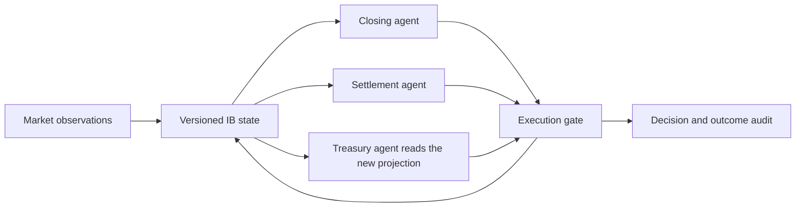

# Investment Banking intelligence and control

The first IB simulator used a single function to identify and execute actions.
Its published benchmark proved a scenario, but could not isolate faulty
decisions, reject a late result, or distinguish an expected receipt from a
committed one when timing deteriorated.

## Decision model

Separate three decision processes and keep the authoritative simulation,
ledger and execution gate in the local IB server. Each process receives a
role-specific snapshot for one clock and evidence revision. The process can
only reply with a typed proposal for its own action. The server verifies
correlation, role, revision, amount, deadline and eligibility against its
current state. It applies recommendations in operational order and rebuilds
the Treasury snapshot after any preceding command. An agent reply never
mutates SQLite, the book, or the simulated market.



- **Closing** sees only the evidence requirements, reported document ETA,
  time to expedite, dependency schedule and the issue cutoff. It proposes
  document acceleration when it advances a closing that is otherwise late.
- **Settlement** sees the trade exception, authorized standing instruction,
  remediation capacity and settlement cutoff. It considers whether repair
  can still preserve settlement. The simulator represents confirmation or
  withdrawal of the standing instruction as a separate observation.
- **Treasury** sees balances available for use by the IB, expected same-day
  receipts, a stressed cash view, critical margin, and the facility limit,
  lead time and fees. The current day includes a single capped facility.
  It can request funding, wait for resolution while a safe time remains, or
  surface an unfillable shortfall. It cannot spend client or issuer cash.

Processes have separate address spaces and no database or credential
configuration. The parent grants read permission only to the worker
entry point and denies filesystem writes and child spawning. Node 24.10
does not provide a network permission flag. The worker has no network
adapter. This is local failure and data isolation for checked-in code,
not a sandbox for untrusted code. Requests have a bounded queue and a
deadline. Timeouts and unavailable agents produce degradation events.
An unavailable agent is retried on a later simulated minute. Timeouts,
foreign revisions and invalid replies have no execution authority.

The IB uses deterministic domain specialists because these decisions
depend on known evidence, arithmetic and hard business controls.
A generative agent can assist with unstructured evidence in a later
integration. It would use the same proposal contract. Independently
reviewed replay reports should inform changes to the policy, with
explicit version promotion and no automatic editing of the rules.

## Public reference points

- [J.P. Morgan, T+1 Trade Affirmation](https://www.jpmorgan.com/content/dam/jpm/cib/complex/content/securities-services/regulatory-solutions/US_T1_Trade_Affirmation_and_TradeSuite_ID_Numbers_March_2024.pdf)
  informs the separation of matching, affirmation, exception handling
  and actual settlement. The project uses its own fictional cutoffs.
- [DTCC Settlement Service Guide](https://www.dtcc.com/legal/rules-and-procedures)
  informs the distinction between prioritization, availability and
  execution risk controls. The local simulator models a single firm
  position, not the DTC settlement queue.
- [Basel liquidity guidance, sections 10.84–10.90](https://www.bis.org/committees/bcbs/basel-consolidated-guidelines/module/lqy/10)
  informs time-specific obligations, uncertain inflows and stress sizing.
- [Basel principles for operational resilience](https://www.bis.org/bcbs/publ/d516.htm)
  inform the exercise of failures and recovery around time-critical work.
- [Federal Reserve SR 26-2](https://www.federalreserve.gov/supervisionreg/srletters/SR2602.htm)
  informs the distinction between review, outcomes testing and ongoing
  monitoring for covered quantitative models. It expressly excludes
  generative and agentic AI from its scope. The project uses it as a
  public control reference, not as an applicability assessment.

These references document practices and principles. They do not disclose
J.P. Morgan's internal implementation or validate the simulator for live
financial operations.

## Reproducible verification

From the repository root, run:

```sh
node --test apps/ib/*.test.mjs
node apps/ib/stress.mjs
node apps/ib/server.mjs
```

The stress harness uses seed `77275174` and checks 774 paired days with up to
24 active simulations. It checks actual transfers, fees, journal
reconciliation, authorization and lead times against independent expectations.
It includes clean, individual and combined disruptions, exact deadlines,
late observations, authority withdrawal and unavailable or capped funding.
Each policy receives the same scenario parameters.

| Deadline met | Reactive | Predictive |
| --- | ---: | ---: |
| Issue closing | 396 | 685 |
| Primary settlement | 573 | 774 |
| Firm settlement | 392 | 581 |
| Margin payment | 304 | 447 |

These are counts from the deliberately synthetic workload. A missed
deadline can be an expected outcome when the input is too late, an
authorization has been withdrawn, or available funding is insufficient.
The runtime checks also exercise a real hung child and restart, stale and
invalid proposals, concurrent operator writes, concurrent benchmark
requests, and compatibility with the existing SQLite day format.

The operating model covers one local intraday session with one borrowing
facility. Production controls such as multilateral netting, authenticated
venue/custodian adapters, portfolio and currency limits, disaster recovery
across hosts, and an independent institution-level validation remain
outside the evidence of this local exercise.
